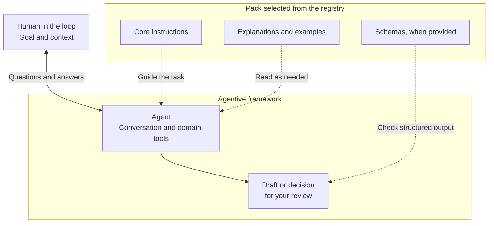

# OHDSI Prompt Registry

Use the registry to find reusable guidance for a task and give your agent a shared way to approach it. A **prompt pack** brings together instructions and, where useful, examples, structured contracts, and review formats.

For example, a research-question pack can help a team turn a study idea into an explicit question. A concept-grounding pack can guide the evidence needed for a mapping decision. The registry makes these packs available through Groundworkers; your agent carries out the conversation and uses the available tools.

## Choose guidance by the decision you need to make

Start with your goal, the setting, and the result you need. Ask your agent to find a suitable pack and explain its scope before applying it:

> Find a prompt pack to help us turn our study idea into a research question. Show us which decisions it covers and what information we need to supply.

The catalogue describes the packs available in your Groundworkers installation. Availability depends on your installed content and local configuration. A pack's scope matters more than a familiar name: guidance for one study setting may need different assumptions from guidance for another.

Different packs can contribute different parts of the work:

| Need | Role of the guidance |
| --- | --- |
| Decide what happens next | Workflow guidance identifies prerequisites, open decisions, and dependent outputs. |
| Clarify something with a person | User elicitation asks a focused question and records the answer or unresolved point. |
| Make a domain decision | Domain guidance supplies relevant rules, evidence requirements, and review criteria. |
| Pass a result to another tool or team | A structured contract defines the information the next consumer expects. |

A workflow can use elicitation when it needs an answer. Elicitation is also useful on its own. Domain rules remain relevant whichever conversation format is used.

## Work with a pack

1. **Agree the scope.** Explain your goal, known constraints, and intended output. Check that the selected pack fits.
2. **Resolve the necessary decisions.** Let the agent use information already supplied and ask about material gaps. State uncertainty rather than choosing an answer you cannot support.
3. **Review the result.** Check assumptions, unresolved questions, and evidence before using an output in further work.

You can ask for a different explanation style or more background without changing the underlying decision. You can also correct an earlier answer; the agent should identify which dependent results need review.

## Read deeper when it helps

Core instructions tell the agent what it needs for the task. Orientation, rationale, and longer examples can be separate references, available when an unfamiliar topic or difficult decision needs explanation.

The registry's selected-content tool reads one declared item at a time. It returns links to other material without fetching their bodies. This supports focused context use; the client or agent still decides which references to request.

## Understand what validation tells you

Some packs use JSON Schemas to check structured inputs and results. These checks help tools agree on fields and permitted values. Other guidance primarily shapes a decision or conversation and does not need a JSON result.

A structurally valid answer still needs the relevant scientific, clinical, or operational review. An answer to a clarification question also needs to be distinguished from approval to perform an action. The registry publishes guidance and checks contracts; the calling application or agent manages execution and session state.

## Find the right guide

For a study-design task, start with [Working on a research question](research-questions.md).

- [Questions and workflow decisions](interactions.md): how clarification, uncertainty, and changed answers fit into work.
- [Choosing and configuring pack sources](sources.md): shared content, local customisation, and overrides.
- [Authoring a prompt pack](pack-format.md): scope, core instructions, optional explanations, and contracts.
- [Tools and structured handoffs](tool-reference.md): exact calls, validation behaviour, and retrieval limits.
- [Development](development.md) and [Python API reference](reference.md): maintaining or embedding the registry.
