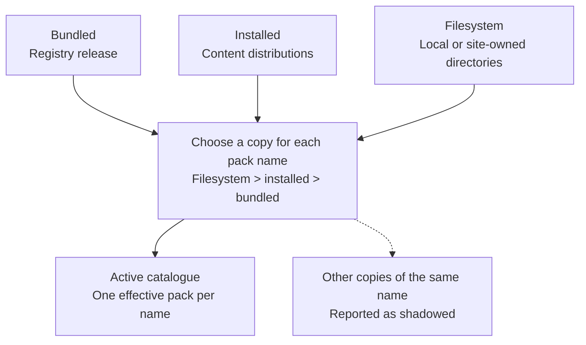

# Choosing and configuring pack sources

Choose a source according to who maintains the guidance and how you want to distribute it. All sources use the same pack format; a source describes where content comes from, rather than what kind of decision it supports.

| Source | Useful for | Precedence |
| --- | --- | ---: |
| Bundled | Baseline content released with the registry. | Lowest |
| Installed | Shared content distributed and versioned separately. | Middle |
| Filesystem | Site-owned guidance, local development, or an intentional override. | Highest |



Use the catalogue to see available content and `ohdsi_prompt_registry_status` to check its effective source. Discovery makes guidance available to an agent; it does not establish its clinical authority or make every pack apply to every task.

## Understand overrides before customising

A pack's manifest `name` is its identity. If two valid packs have the same name, the higher-precedence source replaces the entire lower-precedence pack. Files from the two copies are not merged. Status reports the shadowed source so a local override is visible.

Use the same name when deliberately replacing an existing contract. Use a different name when offering a separate workflow or alternative approach. Check the effective source after configuration so you know which instructions your team is using.

A malformed pack is rejected independently; sibling packs can still load. Status distinguishes rejection from a valid pack being shadowed.

## Bundled content

Bundled packs ship inside `ohdsi-prompt-registry` and are available by default. They include research-question guidance and the generic elicitation and workflow-management capabilities.

```toml
[tools.ohdsi_prompt_registry]
include_bundled = true
```

Choose bundled content when its scope fits your task. A site-specific change can be maintained as a filesystem pack without modifying the registry distribution.

## Installed content

Installed packs come from separate Python distributions, such as `omop-concept-grounding`. Install the distribution into the environment running Groundworkers and restart the host so discovery can register its packs.

Installed discovery is enabled by default. An optional allow-list restricts the active set across sources:

```toml
[tools.ohdsi_prompt_registry]
include_installed = true
enabled_packs = ["omop-concept-grounding"]
```

The allow-list uses manifest names, rather than distribution or entry-point names. Inspect the catalogue after installation to see each pack's instructions, resources, and published prompts.

## Local and site-owned content

Use filesystem packs for local guidance or a working copy of shared content. Set `packs_root` to a directory whose direct children are packs:

```toml
[tools.ohdsi_prompt_registry]
packs_root = "./prompt-packs"
include_bundled = true
include_installed = true
```

A typical layout is:

```text
prompt-packs/
└── my-site-review/
    ├── manifest.yaml
    ├── instructions.md
    └── request.schema.json
```

Relative paths are anchored to the configuration file when Groundworkers supplies `OA_CONFIG_PATH`. Use an absolute path for an unambiguous standalone launch.

Set `packs_root` in the configuration file; the setup console does not expose that field. An existing value is preserved when other fields are edited through the console.

### Shared and personal roots

To keep shared guidance alongside personal working copies, supply roots in ascending precedence:

```toml
[tools.ohdsi_prompt_registry]
packs_root = ["/srv/shared/prompt-packs", "~/work/my-packs"]
```

A pack in the later directory replaces a pack of the same name in an earlier directory, as well as installed or bundled copies. A single root can be supplied as a string. Each root is resolved independently; an unavailable root produces a warning without preventing the others from loading.

To use only a known local set:

```toml
[tools.ohdsi_prompt_registry]
packs_root = "/srv/groundcrew/prompt-packs"
include_bundled = false
include_installed = false
enabled_packs = ["my-site-review"]
```

## Make configuration changes visible

Restart Groundworkers after adding or removing pack directories, changing manifests, or installing content distributions. The host retains its discovered pack set for the process lifetime. Files already declared by an active pack are read on demand, so editing their contents does not require repackaging.

After a restart, inspect status and retrieve the intended instructions. Confirm the effective source, version, and content identity, especially when resuming work or testing an override. Editing source files alone does not restart a running host.

For the content contract and distribution layout, see [Authoring a prompt pack](pack-format.md).
